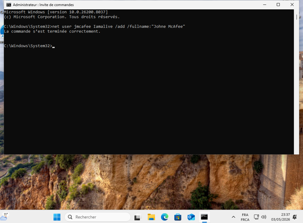
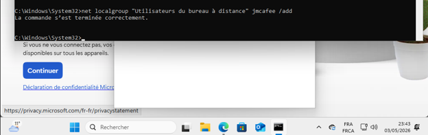
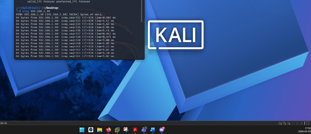
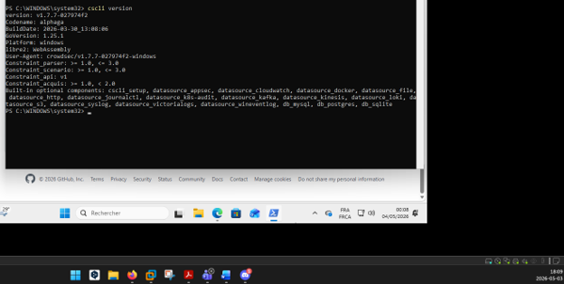
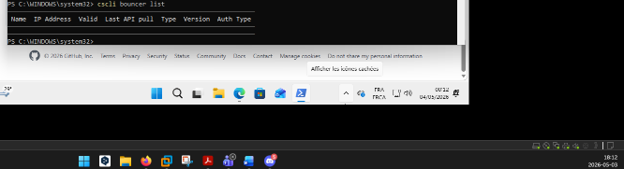
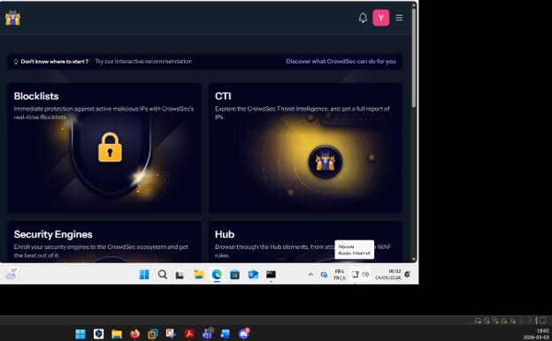
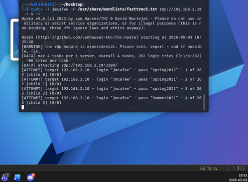
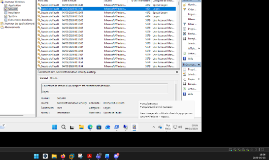
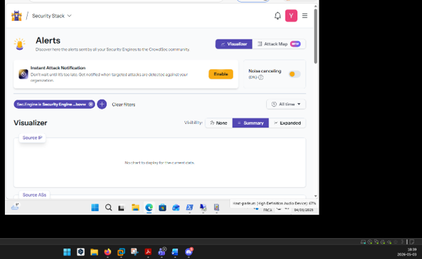

<div align="center">

# 🛡️ Laboratoire CrowdSec

### Détection d'attaques par force brute RDP et protection d'un hôte Windows


**Cours : Piratage et sécurité** · **Auteur : Youssef Lahlali**

</div>

---

> ⚠️ **Périmètre autorisé.** Toutes les manipulations présentées ont été réalisées **uniquement dans un environnement de laboratoire isolé**, sur des machines et des comptes **fictifs créés pour l'exercice**. Ne jamais reproduire ces tests sur des systèmes tiers sans autorisation écrite explicite.

---

## 📌 Résumé du projet

Ce laboratoire met en place une **chaîne de détection et de protection** autour d'un poste Windows exposé à l'accès distant (RDP). Une machine **Kali Linux** simule une tentative d'attaque par force brute sur un compte de test, pendant que **CrowdSec** analyse les journaux de sécurité Windows et que le **bouncer Windows Firewall** est prêt à appliquer les décisions de blocage.

Le projet démontre le cycle complet vu par un analyste sécurité :

```
 Attaque simulée  ──►  Journaux Windows  ──►  Analyse CrowdSec  ──►  Alerte / Décision  ──►  Blocage (bouncer)
   (Kali, Hydra)       (Event ID 4625)       (scénarios)             (Console)              (Pare-feu Windows)
```

> 🎯 **Pourquoi c'est important ?** Les attaques par force brute sur RDP restent l'un des vecteurs d'intrusion les plus courants. Savoir les détecter, les corréler et les bloquer automatiquement est une compétence centrale en **SOC / blue team**.

---

## 🎯 Objectifs

- ✅ Préparer un hôte Windows et une machine Kali Linux dédiés aux essais
- ✅ Configurer CrowdSec et vérifier l'enregistrement du **bouncer Windows Firewall**
- ✅ Observer les échecs de connexion Windows (**Event ID 4625**)
- ✅ Corréler les essais avec les événements et alertes visibles dans CrowdSec
- ⚠️ Évaluer la notification **Telegram** et consigner son état (non fonctionnelle lors de l'essai)

---

## 🗺️ Architecture du laboratoire

```
┌────────────────────────┐          Réseau de laboratoire          ┌──────────────────────────────┐
│   Kali Linux           │ ───────  tentatives d'authentification ─►│   Hôte Windows               │
│   (machine de test)    │               (RDP)                      │   • Compte de test dédié     │
│   Outil de test        │                                          │   • Journaux de sécurité     │
└────────────────────────┘                                          │   • CrowdSec (agent)         │
                                                                    │   • Bouncer Windows Firewall │
                                                                    └──────────────┬───────────────┘
                                                                                   │ alertes
                                                                                   ▼
                                                                    ┌──────────────────────────────┐
                                                                    │   CrowdSec Console           │
                                                                    │   (vue centralisée)          │
                                                                    └──────────────────────────────┘
```

| Composant | Rôle dans le laboratoire |
| --- | --- |
| **Windows** | Hôte surveillé : comptes de laboratoire, journaux de sécurité et pare-feu Windows |
| **Kali Linux** | Machine de test utilisée dans le réseau de laboratoire |
| **CrowdSec** | Analyse des événements et remontée d'alertes |
| **Windows Firewall bouncer** | Composant qui **applique** les décisions de blocage sur l'hôte Windows |
| **CrowdSec Console** | Vue centralisée de l'instance et des alertes |
| **Telegram** | Canal de notification testé ; **non fonctionnel** lors de cet essai |

---

## 🧰 Compétences démontrées

| Domaine | Détails |
| --- | --- |
| **Détection d'intrusion** | Déploiement et vérification de CrowdSec, lecture des alertes |
| **Analyse de journaux** | Exploitation du journal de sécurité Windows, Event ID 4625 |
| **Défense active** | Intégration d'un bouncer au pare-feu Windows |
| **Sécurité offensive (éthique)** | Simulation contrôlée d'une attaque par force brute depuis Kali |
| **Corrélation** | Lien entre horodatage, événement Windows et alerte CrowdSec |
| **Rigueur professionnelle** | Périmètre autorisé, comptes fictifs, aucun secret publié, limites documentées |

---

## 🔬 Déroulement et preuves

### 1️⃣ Préparation du compte de laboratoire

**Objectif :** disposer d'une cible légitime et isolée pour les essais.

**📸 Création du compte de test** — `Screenshots/Creation_user.png`



Création d'un **compte dédié à l'exercice**. Utiliser un compte distinct présente deux avantages :
- on évite d'exposer des identifiants personnels ;
- on identifie facilement les événements générés pendant les essais (le nom du compte sert de repère dans les journaux).

**📸 Ajout au groupe d'accès RDP** — `Screenshots/Ajout_Au_Grp.png`



Le compte est ajouté au groupe autorisant la **connexion Bureau à distance**. Cette étape prépare l'accès distant utilisé dans le scénario.

> 🔒 **Bonne pratique :** cet accès doit rester limité à une machine **isolée** et à un compte de test, jamais à un poste en production.

---

### 2️⃣ Préparation de la machine de test

**📸 Terminal Kali prêt** — `Screenshots/Terminal_Ready.png`



Le terminal de **Kali Linux** est prêt pour le scénario. La machine doit communiquer **uniquement avec les hôtes prévus** dans le réseau de laboratoire, ce qui garantit que les essais ne sortent pas du périmètre autorisé.

---

### 3️⃣ Vérification de CrowdSec et du bouncer

**Objectif :** confirmer que la chaîne de protection est en place **avant** de lancer le moindre test.

**📸 Version de CrowdSec** — `Screenshots/Commande1.png`



Première vérification en ligne de commande : l'affichage de la **version de CrowdSec** confirme que l'outil est installé et accessible sur l'hôte.

**📸 Liste des bouncers** — `Screenshots/Commande2.png`



La liste des bouncers confirme l'**enregistrement du bouncer Windows Firewall**. C'est lui qui transforme une *décision* de CrowdSec (par exemple « bloquer cette adresse IP ») en **règle concrète du pare-feu Windows**.

> 💡 **À retenir :** CrowdSec sépare la **détection** (l'agent qui analyse les journaux) de la **remédiation** (le bouncer qui bloque). Sans bouncer, on obtient des alertes mais aucun blocage.

---

### 4️⃣ Enregistrement et état de l'instance

**📸 Console CrowdSec** — `Screenshots/CrowdSec_Console.png`



La **CrowdSec Console** offre la vue centralisée de l'instance : c'est l'interface utilisée pour suivre l'environnement et consulter les alertes.

**📸 Instance Windows en ligne** — `Screenshots/Wtatus_Online(Crowd).png`


L'hôte Windows apparaît **en ligne** dans la console au moment de l'observation. Cela prouve que l'agent communique bien avec la plateforme et que les événements pourront y remonter.

---

### 5️⃣ Génération et observation des événements

**📸 Essais d'authentification contrôlés depuis Kali** — `Screenshots/Hydra_PsswdTest.png`



Une série d'**essais d'authentification contrôlés** est lancée depuis Kali contre le compte de test, pour simuler une attaque par force brute (nom de capture : *Hydra*). Chaque tentative échouée génère un événement côté Windows.

> ⚠️ Cette capture documente l'activité d'un outil de test dans un cadre **autorisé**. Elle ne constitue **en aucun cas** une autorisation de tester des systèmes tiers.

**📸 Journaux Windows** — `Screenshots/Logs.png`



Les **journaux de sécurité Windows** permettent d'examiner les événements produits par les tentatives de connexion :

| Event ID | Signification |
| --- | --- |
| **4625** | **Échec d'ouverture de session** : l'événement clé de ce laboratoire |
| 4624 | Ouverture de session réussie (utile pour détecter un succès après une série d'échecs) |

L'analyse du **contexte** (compte ciblé, type d'ouverture de session, adresse source) et de l'**horodatage** permet de corréler chaque événement avec le scénario de test.

---

### 6️⃣ Alertes CrowdSec

**📸 Alertes observées** — `Screenshots/Alerts_OnCrowd.png`



La console affiche les **alertes générées pendant le scénario**. Cette preuve illustre la visibilité des événements dans la plateforme après les essais.

> ℹ️ L'interprétation dépend des événements **effectivement reçus** par l'instance : une alerte confirme que la détection a fonctionné, mais il faut la rapprocher des journaux Windows pour valider la corrélation.

---

## 📊 Résultat et limites

| Élément | État |
| --- | :---: |
| Préparation des machines et du compte de test | ✅ |
| Vérification de CrowdSec (version) | ✅ |
| Bouncer Windows Firewall enregistré | ✅ |
| Instance Windows visible en ligne dans la console | ✅ |
| Essais contrôlés depuis Kali | ✅ |
| Observation des événements Windows (Event ID 4625) | ✅ |
| Alertes visibles dans CrowdSec | ✅ |
| **Notification Telegram** | ❌ **Non fonctionnelle lors de ce test** |

> La notification Telegram **n'a pas fonctionné** lors du test : elle reste à dépanner et à valider avant de pouvoir être présentée comme opérationnelle. Je préfère le documenter honnêtement plutôt que de le masquer : savoir identifier et consigner les limites d'un système fait partie du travail d'un analyste.

---

## 🧩 Ce que j'ai appris

- **Détection ≠ protection** : un agent détecte, un bouncer bloque. Les deux doivent être vérifiés séparément.
- **L'Event ID 4625** est la base de la détection de force brute sous Windows.
- **Isoler le laboratoire** et utiliser des comptes fictifs est indispensable pour pratiquer légalement et sans risque.
- **Documenter les échecs** (comme Telegram) est aussi important que documenter les réussites.

---

## 🚀 Améliorations possibles

- [ ] Ajouter les **versions exactes** de Windows, CrowdSec, du bouncer et des autres composants
- [ ] Documenter les **étapes d'installation** et les paramètres réellement appliqués (sans inclure de secrets)
- [ ] **Diagnostiquer la notification Telegram** et n'ajouter une preuve qu'après un test réussi
- [ ] Clarifier les **critères de corrélation** entre l'événement Windows, l'alerte CrowdSec et toute décision du bouncer
- [ ] Capturer et documenter une **décision de blocage** effective dans le pare-feu Windows
- [ ] Mesurer le **temps de détection** entre la première tentative échouée et l'alerte

---

## 🔐 Sécurité et confidentialité

- Les commandes de test sont exécutées **uniquement** dans un environnement isolé et explicitement autorisé.
- **Aucun** mot de passe, jeton Telegram, clé privée, adresse publique sensible ou renseignement personnel n'est publié dans ce dépôt.
- Les comptes et identifiants de laboratoire sont **fictifs**.

---

## 📂 Structure du dépôt

```
📦 crowdsec-lab
 ┣ 📂 Screenshots
 ┃ ┣ Creation_user.png
 ┃ ┣ Ajout_Au_Grp.png
 ┃ ┣ Terminal_Ready.png
 ┃ ┣ Commande1.png
 ┃ ┣ Commande2.png
 ┃ ┣ CrowdSec_Console.png
 ┃ ┣ Wtatus_Online(Crowd).png
 ┃ ┣ Hydra_PsswdTest.png
 ┃ ┣ Logs.png
 ┃ ┗ Alerts_OnCrowd.png
 ┗ 📄 README.md
```

---

## 👤 Auteur

**Youssef Lahlali** : Étudiant en administration des réseaux et systèmes
🔎 À la recherche d'un **stage** en administration systèmes / réseaux / cybersécurité

📧 *ton.courriel@exemple.com* · 💼 *linkedin.com/in/ton-profil*

---

<div align="center">

⭐ *Si ce projet t'a été utile, n'hésite pas à laisser une étoile !*

</div>
